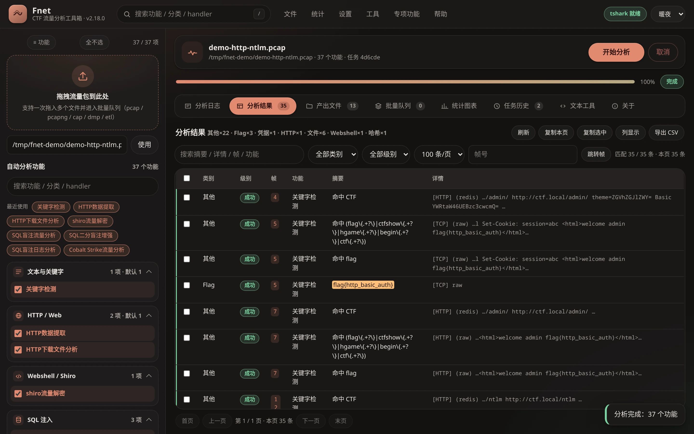

# Fnet

[](LICENSE)
[](pyproject.toml)
[](https://www.wireshark.org/)
[](pyproject.toml)
[](https://github.com/fyfhcgch/Fnet/pulls)

Fnet 是一个面向 CTF 与流量取证的开源网络流量分析工具箱。它把常见赛题里的
“找 flag、找凭据、解协议、还原文件”等操作集中到一个本地 WebUI 中。

**English** — Fnet is a stdlib-only Python toolkit for CTF and network forensics:
point it at a pcap/pcapng, tick the checks you need, and read flags, credentials,
reassembled files and decrypted traffic in a local WebUI or from the CLI. Protocol
parsing is delegated to `tshark`, so there are no Python dependencies to install.

在线教程与功能介绍：<https://fyfhcgch.github.io/Fnet/>

## 快速开始

### 1. 安装系统依赖

Fnet 的协议解析依赖 Wireshark 的命令行工具 `tshark`。

### 2. 运行

从源码目录直接运行：

```bash
cd Fnet
python3 -m fnet
```

浏览器会自动打开 <http://127.0.0.1:8765>。常用参数：

```bash
python3 -m fnet --no-browser            # 不自动打开浏览器
python3 -m fnet --port 9000             # 换端口
python3 -m fnet capture.pcapng          # 启动并预选流量包
python3 -m fnet capture.pcapng --features checkBox_10,http.extract
python3 -m fnet --doctor                # 检查 tshark / java / hashcat 等
python3 -m fnet --list-features         # 列出 50 个功能与复选框编号
```

WebUI 顶栏可切换中文 / English；大文件上传显示进度并可按 `Esc` 取消，
分析过程中可在功能边界暂停/继续，也可在“任务历史”里对比两个任务的结果。
工具栏的“实时抓包”会枚举 `tshark -D` 的网卡，停止后可直接送入分析。

也可以安装成命令（PyPI 发行名为 `fnet-ctf`，安装后仍是 `fnet` 命令）：

```bash
pipx install fnet-ctf
# 或从源码
python3 -m pip install .
fnet
```

### 3. 无界面分析

```bash
# 运行默认勾选的功能，日志直接打印到终端
python3 -m fnet -C capture.pcapng

# 运行全部 50 个功能
python3 -m fnet -C capture.pcapng --all

# 只运行指定功能（复选框编号或 handler 均可）
python3 -m fnet -C capture.pcapng --features checkBox_10,webshell.decrypt

# 传入功能参数
python3 -m fnet -C capture.pcapng --features checkBox_37 \
  --param webshell_password=pass --param shiro_key=<base64>

# 机器可读输出（任务、findings、统计、产出）
python3 -m fnet -C capture.pcapng --features checkBox_10 --json

# 无状态功能按帧区间分片；已知 WPA PSK / Kerberos 密钥时直接解密
python3 -m fnet -C capture.pcapng --features checkBox_10 --shards 4
python3 -m fnet -C wifi.pcap --features checkBox_18 --wpa-psk 'password'
python3 -m fnet -C krb5.pcap --features checkBox_45 --keytab /etc/krb5.keytab

# 导入自定义正则/YARA 子集规则，命中写入 findings
python3 -m fnet -C capture.pcapng --features checkBox_30 --rules rules.yar

# 继续已暂停/中断的任务，或对比两个任务的发现
python3 -m fnet --resume <job-id>
python3 -m fnet --compare <base-job-id> <target-job-id> --json

# MCP stdio 服务器：把功能列表/分析/findings/帧上下文暴露为 MCP 工具（JSON-RPC 2.0）
python3 -m fnet --mcp
# 预载默认流量包，analyze 工具可省略 pcap_path
python3 -m fnet --mcp capture.pcapng

# PCAP-over-IP：监听 127.0.0.1:18000 接收 pcap 字节流，连接关闭后自动分析
python3 -m fnet --pcap-over-ip 18000 --features checkBox_10
```

无界面分析、PCAP-over-IP 与 MCP server 三种命令行模式的详细说明见
[`docs/CLI.md`](docs/CLI.md)。

报告与导出文件写入 `~/.cache/fnet/jobs/<job-id>/`，终端会列出
`report.txt`、`report.md`、`report.html` 与结构化结果
`findings.json` / `findings.csv` 的路径。

tshark 字段提取默认启用磁盘缓存与超时重试，可通过 `config.ini` 的
`tshark_cache`、`tshark_retry`、`tshark_timeout`、`tshark_max_field_kb`、
`tshark_max_rows` 调整缓存与内存上限。

## WebUI 界面



| 区域       | 说明                                                                                                             |
| ---------- | ---------------------------------------------------------------------------------------------------------------- |
| 左侧功能栏 | 50 个功能按 13 个分类折叠展示，可全选/全不选                                                                 |
| 顶部       | 全局功能搜索、文件/统计/设置/工具菜单、tshark 状态、语言切换、主题切换                                           |
| 主区域     | 关键字、HTTP、Webshell、SQL、认证、C2、工控、杂项、文本、设置、关于                                              |
| 分析结果   | 凭据、哈希、flag、导出文件等汇总为可排序表格，支持筛选、搜索、分页、列显示/隐藏、批量复制、按帧号跳转与 CSV 导出 |
| 任务历史   | 保存历次分析记录，可回看报告、一键重跑、对比两个任务的 findings diff 或删除                                      |
| 批量队列   | 一次拖入多个流量包，按并发数排队执行，可暂停/继续、拖拽排序、逐包查看日志、取消并合并报告                        |
| 统计图表   | 流量时间线、协议分层、Top 会话与会话拓扑；时间线支持缩放/框选与点击下钻，图表可导出 SVG/PNG                      |
| 日志区     | 级别过滤、关键字过滤、复制、导出、进度与取消；日志中的帧号可点击定位数据包                                       |
| 产出区     | 任务结束后列出报告与导出文件，可单文件下载或打包下载                                                             |
| 报告导出   | 自动生成 `report.txt` / `report.md` / `report.html`，可自选章节，HTML 可直接打印为 PDF                           |

侧栏提供功能搜索与“最近使用”快捷入口：搜索会匹配功能名称、说明、分类与
handler，最近使用的复选框会保存在浏览器本地，便于重复执行常用分析。

“文件”菜单里的“查看 HTML 报告 / 导出分析报告…”使用同一套报告渲染器：
任务详情、功能清单、关键发现、完整日志、产出文件与分析参数都可以单独勾选，
HTML 报告自带样式、无需联网，适合直接交付或打印成 PDF。

界面为响应式布局：窄屏自动堆叠，宽屏保持双栏工作区；视觉上采用暖中性色加
陶土红强调色（参考 EBCTFCodeBox 的 Material 3 取向），提供暖夜、暖昼、浅樱、
暮玫、莓紫五套配色，选择会保存在浏览器本地。

“分析结果”页把日志里值得汇总的内容（凭据、哈希、flag、Webshell/SQL 还原
结果、导出的文件等）整理成表格：可以按类别与级别筛选、搜索、点击表头排序、
分页浏览并调整每页条数、切换显示的列、复制本页或选中行、按帧号跳转，也可
导出 CSV；任务结束时相同数据也会写入输出目录的 `findings.json` 与
`findings.csv`。哈希类结果的详情弹窗还能一键调用 hashcat 破解：可指定字典、
加速档位、`-O`、`--force`、超时和附加参数，日志与密码实时回显，设置会持久化。

日志与分析结果中的“帧 N”是可点击按钮：弹窗会显示该帧的摘要、前后文帧和
`tshark -V` 解码详情，可一键导出包含上下文的小 pcapng 片段，或在检测到
Wireshark 时直接打开对应帧。

### 自定义规则

“设置 → 自定义规则…”或 `POST /api/rules` 可以导入规则文件，支持逐行正则与
YARA 子集（`strings`/`condition`、`any/all/N of them`、`$a and $b`）。命中
结果会写入 findings 的“自定义规则”类别（包含规则名、帧号、协议与片段），
并参与报告、CSV 导出与任务对比。规则文件路径保存在 `paths.rules_file`，
也可用 `--rules` 为单次任务临时覆盖。

### 任务对比与断点续跑

`GET /api/compare?base=<id>&target=<id>` 会对比两个任务的 findings，返回
`added`/`removed`/`common` 与按类别统计；WebUI 的“对比两个任务”与
`--compare` 使用同一实现。任务在功能边界保存 `completed` 与
`feature_status`，因此暂停后可以“继续”或 `--resume` 从断点恢复；无状态
功能还能用 `--shards N` 按帧区间并行分析。

### 性能基准

[`docs/PERFORMANCE.md`](docs/PERFORMANCE.md) 由 `scripts/bench.py` 生成，
记录 10 MB / 100 MB / 1 GB 抓包上每个功能的耗时与峰值 RSS。1 GB 抓包的
关键字检测采用分块扫描，内存稳定在约 150 MB；重新生成：

```bash
python3 scripts/bench.py --sizes 10,100,1000 --features default
```

## 外部工具

| 工具                   | 用途                             | 是否必需 |
| ---------------------- | -------------------------------- | -------- |
| `tshark`               | 所有协议解析与字段提取           | **是**   |
| `java`                 | 反编译、部分 Webshell/序列化分析 | 可选     |
| `hashcat` / `john`     | 哈希爆破                         | 可选     |
| `foremost` / `binwalk` | 文件分离                         | 可选     |
| `aircrack-ng`          | Wi-Fi 握手包处理                 | 可选     |
| `hcxtools`             | 生成 16800/22000 等哈希格式      | 可选     |
| `pcapfix`              | 修复损坏的 pcap                  | 可选     |
| `etl2pcapng`           | Windows ETL 转 pcapng            | 可选     |
| `pyrdp-player`         | RDP 会话回放                     | 可选     |

用 `python3 -m fnet --doctor` 查看本机检测结果；缺失的可选工具只会让对应
功能降级，不影响其它分析。

## 功能一览

完整列表与每个功能的输入/输出、依赖见 [`docs/FEATURES.md`](docs/FEATURES.md)。
分类概览：

- **文本 / HTTP**：关键字与编码识别、深度 flag 扫描（重组流/导出文件/二进制载荷，带来源与置信度）、HTTP 请求响应提取、登录凭据、Basic 认证。
- **会话 / 协议**：TCP/UDP 会话、DNS、ICMP、ARP、FTP、SMTP、Telnet、MySQL；
  额外支持 Redis、MongoDB、PostgreSQL、LDAP、SMB2/3、WebSocket 与 HTTP/2。
  Redis/MongoDB/PostgreSQL 会先做 TCP 流重组，再解析 RESP3、OP_MSG/SCRAM/GridFS、
  扩展查询/COPY 等深层协议内容；HTTP/2 内置 HPACK 与 DATA 正文还原，SMB2/3
  可还原共享、DFS、命名管道与文件内容。
- **Web 安全**：SQL 注入（含盲注时间/布尔）、Webshell 明文与哥斯拉/冰蝎 3.x/4.x/蚁剑/菜刀/天蝎解密（规则表驱动、请求响应配对、内存马与命令输出还原）、Shiro `rememberMe`（CBC/ECB/GCM）。
- **认证 / C2**：NTLM 哈希、Kerberos 票据、WinRM、Cobalt Strike Beacon。
- **工控 / 无线**：Modbus、S7comm、MQTT、BACnet、DNP3、OPC UA、Wi-Fi EAPOL/PMKID/WPA3/SAE 与 hashcat 22000 命令。
- **其它**：TLS/QUIC 解密（keylog、带口令私钥与证书匹配、证书链/KeyUpdate、解密后的 HTTP/2/gRPC/WebSocket/HTTP3 与凭据文件提取）、RDP、USB 键盘/鼠标、文件分离、EV3/SCSI/IPID 等。

## 项目结构

```
Fnet/
├── fnet/
│   ├── __main__.py        python -m fnet
│   ├── cli.py             参数解析、无界面运行、启动 WebUI
│   ├── app.py             对象图组装（WebUI/CLI/测试共用）
│   ├── jobs.py            后台任务、进度、取消、断点/分片、对比、报告与导出
│   ├── live.py            tshark 实时抓包控制器
│   ├── findings.py        结构化结果（类别、级别、筛选、CSV）
│   ├── report.py          纯文本/Markdown/HTML 报告渲染与章节选择
│   ├── config.py          config.ini 读写与默认值
│   ├── features/          50 个分析功能（按主题拆分）
│   ├── tools/runner.py    外部工具发现与 tshark 封装
│   ├── utils/             编解码、AES/RC4/MD4/RSA、pcap、TCP 流重组、
│   │                      MySQL/Kerberos/邮件/隧道/WPA/规则解析
│   ├── webui/             HTTP 服务与静态页面
│   └── assets/            字典、Shiro 密钥、图标、默认配置
├── docs/                  架构、功能、WebUI、安全说明
├── scripts/               样例抓包生成、性能基准
├── tests/                 单元测试、API 冒烟测试与样例 pcap
└── packaging/             Linux 桌面入口与安装脚本；install.ps1 为 Windows 一键安装
```

## 开发与测试

```bash
python3 -m pip install -e '.[samples]'   # 安装测试所需的 scapy
python3 scripts/make_samples.py          # 生成 tests/data/*.pcap
python3 -m unittest discover -s tests -v
node --check fnet/webui/static/app.js    # 前端语法检查
```

测试覆盖纯 Python 加密实现（AES/GCM/MD4/RC4/RSA 向量）、编解码、功能注册表、
WebUI API 冒烟、UI 规格完整性，以及样例抓包上的关键断言。`tests/test_roadmap.py`
额外覆盖流式上传、自定义规则、暂停/继续、任务对比、CLI JSON 与
`--shards`/`--resume`，以及 DNS/ICMP 隧道、SMTP、MySQL、Kerberos、WPA 的集成；`tests/test_live.py` 用桩 `tshark`
验证实时抓包的 start/stop、单实例限制与重复停止。CI 在 Python 3.10–3.13 上
安装 `tshark` 后运行全量测试；Docker 镜像与 Compose 文件位于仓库根目录。

## 许可证

本项目以 [Apache License 2.0](LICENSE) 发布。Fnet 的名称、图标与代码均为
独立实现；第三方商标与素材归各自权利人所有。
